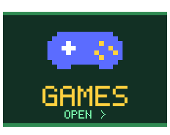
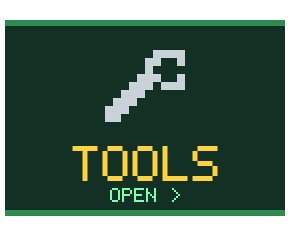
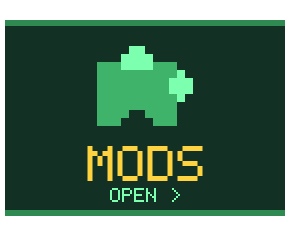
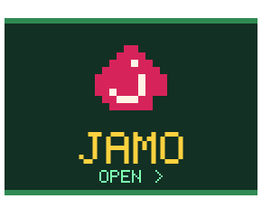
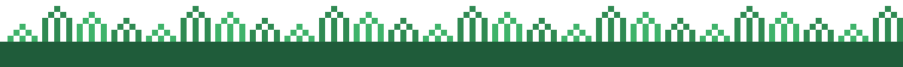

  

  
  

  
  
  
  

## Games

| Game | What it is |
|---|---|
| **[Star Guard](https://github.com/jamolang/jamo/blob/main/examples/star_guard.jamo)** | An arena shooter against waves of alien drones, written in my own language |
| **[Sky Hopper](https://github.com/jamolang/jamo/blob/main/examples/platformer.jamo)** | A three-level platformer with springs, spikes and coins, also in Jamo |
| **[Beat Run](https://github.com/jamolang/jamo/blob/main/examples/beat_run.jamo)** | A one-button rhythm game whose whole song is made in code |
| **Voxel Destruction** | A city made of blocks to wreck with bombs, rockets, nukes and meteors |
| **Primordia** | An evolution sim: creatures with little neural-net brains that split into new species |
| **Neon Arena** | A 3D shooter in a neon arena, with a boss every five waves |
| **Lights Out** | A horror maze where the creature only moves when your flashlight isn't on it |
| **Void Hunter 3D** | Waves of enemies on a moon base, with three guns |
| **Beat Dash** | A one-button rhythm game in the browser |
| **[Infinideck](https://github.com/Silverrshard/Infinideck)** | A card game that keeps growing |

## Tools

| Tool | What it does |
|---|---|
| **Launcher Hub** | Opens every game and tool I've made from one place |
| **Game Hub** | A library of every game on my PC, with playtime, screenshots and mod switches |
| **Vault Star Map** | My notes as a 3D galaxy: every note is a star, every link a thread of light |
| **Pack Launcher** | A launcher for my Minecraft modpacks, with a 3D rocket made in Blender |
| **Bongo** | A pixel gorilla that lives on my desktop and notices what I'm doing |
| **Jamo Playground** | Write and run Jamo in a window |

## Mods

| Mod | For | What it adds |
|---|---|---|
| **Night Stalker** | Minecraft | A boss that hunts you at night |
| **Superhero** | Minecraft | Superpowers that level up as you win fights |
| **Space Mod** | Minecraft | A rocket to the Moon and Mars, with low gravity, space suits and aliens |
| **Half Sword Mod Menu** | Half Sword | An in-game menu, opened with 9 |

<h3 align="center">What I build with</h3>

  
  
  
  
  
  
  
  

  

